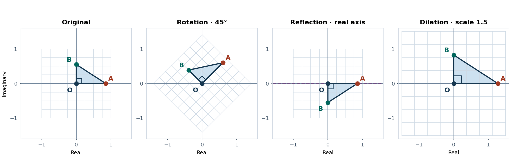

# PyConformal Engine

[](https://github.com/cavegap/pyconformal-engine/actions/workflows/ci.yml)
[](https://opensource.org/licenses/MIT)
[](https://www.python.org/downloads/)

**Conformal mapping in Python for complex analysis courses.** PyConformal turns
a 2015 Universidad del Tolima thesis on conformal mappings, originally
implemented in Maple 17, into runnable examples and mathematical tests.

[Explore the public gallery](https://cavegap.github.io/pyconformal-engine/) ·
[Thesis companion](docs/thesis-guide.md) ·
[Research preview v0.1.0a1](docs/releases/v0.1.0a1.md)

Start with one route: **learn conformality**, **explore boundary problems
and electronics**, or **map the Moon**. The public gallery links each
route to interactive examples, explanations and reader exercises.



All four panels use the same scale. The original vertices are
`O=(0,0)`, `A=(0.85,0)`, and `B=(0,0.55)`. The square at `O`
marks the right angle. Follow `O`, `A`, and `B` in order to see how
reflection across the dashed real axis reverses orientation. Dilation
multiplies all side lengths by 1.5.

[Explore the Group P notebook (Spanish)](notebooks/01_grupo_P.ipynb) ·
[Reproduce the figure](examples/README.md) ·
[Share classroom feedback](https://github.com/cavegap/pyconformal-engine/issues/new)

### Interactive examples

The [thesis companion](docs/thesis-guide.md) pairs passages and figures
with runnable examples. Work through [ten reader exercises](docs/exercises.md),
compare [worked checkpoints](docs/exercise-solutions.md), and run
`python examples/reader_checks.py` after installation. The
[reproduction guide](docs/reproducibility.md) documents assets and commands;
[future-work questions](docs/future-work.md) give validation criteria for
extensions. Completed local changes are recorded in the
[development log](docs/development-log.md).

Open the [visual gallery](examples/index.html) for the complete sequence.
The new [Group P explorer](examples/group-p.html) lets you drag O, A and B
and compare the same angle under rotation, reflection and dilation.
Figure presets connect to the thesis matrix diagrams. Continue to the
[curves and tangent vectors](examples/conformal-angle.html) of Figure 3.2.
The [logarithmic object example](examples/object-reveal.html) recovers a
house from an inverse-designed exponential deformation.

Download [The square map](examples/square-map.html) and open it in a browser.
Drag a point across the Universidad del Tolima outline to see how
`w = z²` changes scale and preserves angles away from the origin. The demo
runs offline and includes keyboard-accessible controls.

In [From disk to half-plane](examples/disk-to-halfplane.html), follow a point
through the Cayley map. The unit circle maps to the real axis, and the pole
at `z = -1` maps to infinity. Download and open the HTML file to explore it.

In [The exponential map](examples/exponential-map.html), see how horizontal
and vertical lines become rays and circles. Compare source points at
−180° and +180° to explore the period.

### Schwarz–Christoffel square

Open [From half-plane to square](examples/schwarz-christoffel-square.html)
from the complete checkout, keeping `sc-square.js` beside the page.
Move a point across the half-plane or select a prevertex to
see its corresponding corner. The [technical notes](docs/schwarz-christoffel-square.md)
document the normalization, mapped grid, and numerical validation.
The [second SC example](examples/schwarz-christoffel-heat.html) transports
a steady heat-conduction problem with varying temperatures on all four edges.

### Coplanar waveguide

Open the [50 Ω CPW example](examples/coplanar-waveguide.html) in a browser
to size the gap and visualize the field in the idealized cross-section.
See the [model and verification](docs/coplanar-waveguide.md).

### Coplanar capacitive sensor

Open the [sensor example](examples/coplanar-sensor.html) to visualize
how electrode spacing affects coupling capacitance. See the
[boundary-element comparison](docs/coplanar-sensor.md).

## Project status

**Pre-alpha.** The Chapter 1 implementation covers rotations, reflections,
dilations, their compositions and inverses, and tests of the chapter's theorems.
Chapter 3 examples include the Cayley map, the exponential map, and the
Schwarz–Christoffel square with fixed prevertices. The
[lunar Mercator example](docs/lunar-mercator.md) applies the cubic map
from Chapter 4 to a georeferenced LROC mosaic crop, with three named
craters and a local scale plot. General polygon mappings are on the
[roadmap (Spanish)](ROADMAP.md).

The [recovered lunar outlines](docs/lunar-thesis-outlines.md) compare
the original Figure 4.5 shapes under the square and cube maps and
overlay the same outlines on the LROC mosaic in Peirce's projection.
Open the [interactive outline explorer](examples/lunar-thesis-interactive.html)
to follow individual boundary points from an orthographic lunar globe to
the Mercator tracing and z², z³, Log(1 + z), or Peirce.

The [global lunar mosaic in Peirce's projection](docs/peirce-mosaic.md)
shows both hemispheres, four named craters and a local-scale panel.
The [unified Peirce atlas](examples/peirce-atlas.html) combines structural,
imagery, scale and joined-tile views while retaining the same selected point.
The [graticule](docs/peirce-global.md) documents the cuts and comparison
against PROJ.
The [Mercator-to-Peirce comparison and tiling](examples/peirce_tessellation.png)
shows how alternating half-turn copies join along square boundaries.
The [applications roadmap](docs/applications-roadmap.md) describes the next
examples and how each will be validated.

## Installation

From the repository root, install the package with Python 3.10 or later.

```bash
python -m pip install -e .
```

For notebook and development tools, use `python -m pip install -e ".[dev,notebooks]"`.

## Quick start

Reflect a point across the real axis.

```python
from pyconformal.linear import Reflection

reflect = Reflection(0)
print(reflect(1 + 2j))                # (1-2j)
print(reflect.preserves_orientation)  # False
```

Map the center of the unit disk to the upper half-plane.

```python
from pyconformal.mobius import disk_to_upper_half_plane

print(disk_to_upper_half_plane(0j))  # 1j
```

## Academic attribution

> **Vega Penagos, C. A. & Olivero Zapata, H. A.** (2015).
> *Implementación en software de aplicaciones conformes*.
> Undergraduate thesis, Mathematics with an Emphasis in Statistics,
> Faculty of Sciences, Universidad del Tolima, Ibagué, Colombia.
> Advisor Juan Pablo Yáñez Puentes.

The [original thesis](thesis/) is the primary reference. Please cite it when
using PyConformal in academic work. See [citation metadata](CITATION.cff).

## Repository layout

| Path | Contents |
| --- | --- |
| [`src/pyconformal/linear/`](src/pyconformal/linear/) | Group P implementation |
| [`tests/`](tests/) | Software tests and mathematical properties |
| [`notebooks/`](notebooks/) | Jupyter tutorials |
| [`examples/`](examples/) | Scripts that generate figures |
| [`thesis/`](thesis/) | Original thesis |
| [`ROADMAP.md`](ROADMAP.md) | Planned modules and their references to the thesis |

## Contributing

Run `pytest`, `ruff check .`, `ruff format --check .`, and `mypy` before
opening a pull request. When implementing a theorem or example, cite its chapter,
section, theorem or figure number, and page in the docstring.

## License

[MIT](LICENSE)
