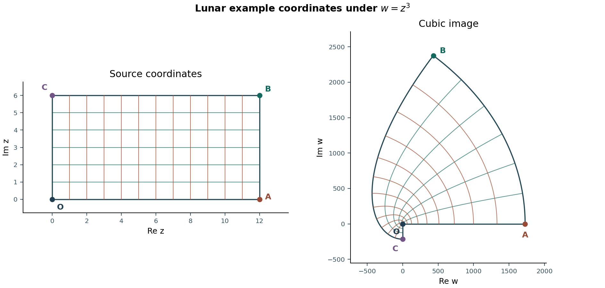

# Lunar cubic coordinate grid

Section 4.2 of Vega Penagos & Olivero Zapata (2015), p. 57, specifies
`w = z³` to the rectangle with opposite corners `0` and `12 + 6i`
in a lunar Mercator example. The accompanying Maple archive contains
`original luna.mw` and `mapeo luna.mw`. The latter has a section titled
`Transformacion Conforme Z^2`. This example follows the cubic formula
stated in the text and caption. The [recovered vector outlines](lunar-thesis-outlines.md)
show that the image panel in Figure 4.5 was plotted with the square map.



The lines sample the thesis coordinates at unit spacing in both
directions. Both panels use equal axis scales within each plot.

| Point | Source | Image |
| --- | --- | --- |
| O | 0 | 0 |
| A | 12 | 1728 |
| B | 12 + 6i | 432 + 2376i |
| C | 6i | −216i |

Run this from the repository root after installing the package.

```bash
python examples/lunar_cubic_grid.py
```

## Coordinate conventions for the raster stage

The source coordinates are planar and dimensionless here. The
[lunar Mercator example](lunar-mercator.md) applies this geometry to a
georeferenced LROC crop, using the same scale on both source axes.

The rectangle lies in the first quadrant. For nonzero points, cubing
triples the polar angle from the interval `[0, π/2]` to `[0, 3π/2]`.
That interval is shorter than a full turn, so each image point has a
unique preimage in the rectangle. For inverse resampling, take the image
argument counterclockwise from the positive real axis in `[0, 2π)`,
divide by three, and take the cube root of the radius. Mask points whose
arguments lie above `3π/2` or whose recovered coordinates lie outside
the source crop. Handle the origin separately. The scale of the cubic
map in the source plane is `3|z|²`, and the derivative vanishes at the
origin. This scale is relative to the projected coordinates.
