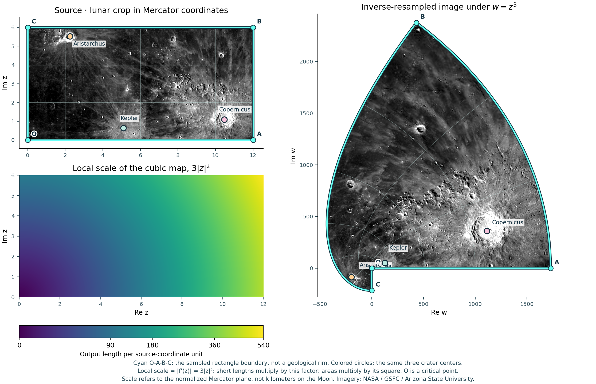

# Lunar Mercator crop under the cubic map

This example follows the method in §4.2 of Vega Penagos & Olivero Zapata
(2015), using a modern LROC crop and the thesis domain
`[0, 12] × [0, 6]`. The control points identify three craters in both
views. The scale plot measures the additional stretching from cubing
relative to the normalized Mercator plane.



## Image source and registration

The supplied `examples/lunar-lroc-wac.jpg` is a grayscale image requested
from the ASU LROC WMS, layer `luna_wac_global`. The geographic image
covers longitudes 55° W to 15° W and latitudes 2° N to 28° N at 800 by
520 pixels. The WMS request uses an east-positive WGS84-style axis
convention (`SRS=EPSG:4326`) to express lunar longitude and latitude in
degrees. The reprojection uses a spherical Moon.
[LROC product and attribution](https://data.lroc.im-ldi.com/lroc/view_rdr/WAC_GLOBAL) ·
[WMS image request](https://webmap.lroc.asu.edu/?SERVICE=WMS&VERSION=1.1.1&REQUEST=GetMap&LAYERS=luna_wac_global&STYLES=&SRS=EPSG:4326&BBOX=-55,2,-15,28&WIDTH=800&HEIGHT=520&FORMAT=image/jpeg)

| Crater | East-positive longitude | Latitude |
| --- | ---: | ---: |
| [Aristarchus](https://planetarynames.wr.usgs.gov/Feature/380) | −47.49° | 23.73° |
| [Kepler](https://planetarynames.wr.usgs.gov/Feature/2990) | −38.01° | 8.12° |
| [Copernicus](https://planetarynames.wr.usgs.gov/Feature/1296) | −20.08° | 9.62° |

LROC WAC imagery credit goes to NASA/GSFC/Arizona State University.
The requested crop is supplied so the example can regenerate offline.
[Speyerer et al., 2011](https://www.lpi.usra.edu/meetings/lpsc2011/pdf/2387.pdf)

## Mapping

$$
f(z)=z^3,\qquad |f^{\prime}(z)|=3|z|^2,\qquad J(z)=9|z|^4.
$$

See the [notation guide](notation.md) for domains, units and symbol conventions.

We place the Mercator origin at longitude 55° W and latitude 6° N.
The 40° longitude span sets 12 source units, and the same angular
scale sets the vertical dimension in spherical Mercator coordinates.
The top edge is the latitude whose Mercator ordinate is 6 units above
the origin. The output is sampled by taking the first-quadrant inverse
of the cubic and looking up the corresponding original WMS pixel.
Samples outside the rectangle are masked. The local scale on the source
plane is `3|z|²`.

From the repository root after installing the package, run:

```bash
python examples/lunar_mercator.py
```
