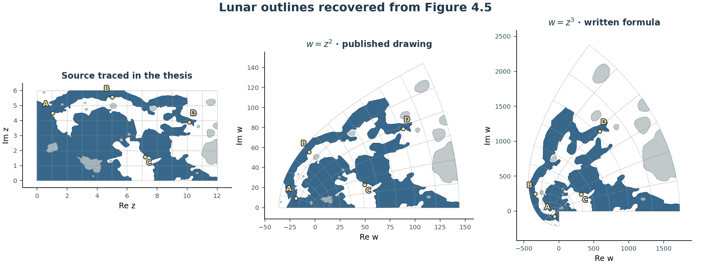
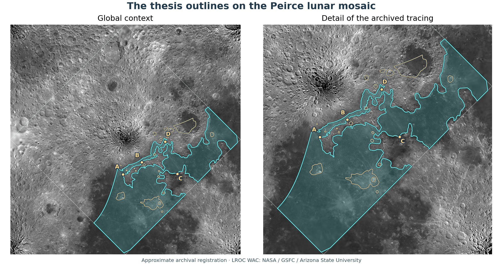

# Lunar outlines from Figure 4.5

This example recovers the hand-traced shapes in §4.2, p. 57, of the thesis
by Vega Penagos & Olivero Zapata (2015). It reads the 21 vector paths and
axis ticks embedded in the published PDF. The data include the blue
outline and 20 gray paths, with coordinates measured from the printed
figure. The archived Maple worksheets corroborate the drawing workflow.
`original luna.mw` contains `borde`, `crisis` and the numbered shapes.
`mapeo luna.mw` contains a section headed `Transformacion Conforme Z^2`.

Open the [interactive outline explorer](../examples/lunar-thesis-interactive.html)
to select a point on the traced edge and follow it from an orthographic
lunar globe to the Mercator frame and a selected transformation. Choose
the square, cube, Peirce, or the new `w = Log(1 + z)` comparison. The
four labeled vertices match the static figures. Peirce mode provides a
global view and a zoom. Approximate lunar coordinates remain visible in
all modes. The cyan primary contour and gold secondary contours have
dark halos for contrast over imagery.

The globe is centered at longitude 0°, latitude 30° N. It gives spherical
context and uses the same approximate registration as the Peirce overlay;
the orthographic display itself is not conformal. The generator derives
all contour samples from the archival Mercator coordinates before either
spherical display, so the point indices correspond in all three panels.

The new principal logarithm is analytic throughout the source rectangle
because `Re(1 + z) > 0`. Its derivative is `1/(1 + z)` and has no zero
there. It compresses distant parts of the tracing without crossing a
branch cut. This comparison is an extension of the thesis, not a claim
about the transformation in the historical figure.



## Which map produced the published panel?

The prose and caption specify `w = z³`. The plotted points match
`w = z²`. For each published image vertex, the table reports the
distance to the nearest transformed source vertex, in the published
image's coordinate units. The 0 and 20 ticks fix the plotted scale.
The nearest-vertex comparison allows for different path sampling
and clipping in the two PDF panels.

| Candidate | Median distance | 95th percentile |
| --- | ---: | ---: |
| `z²` | 0.00597 | 0.0183 |
| `z³` | 11.475 | 40.914 |

For the new plots, each original edge is sampled before applying
the map. The labels A, B, C and D track four vertices of the same
blue outline in all panels.

## The same outlines in Peirce's projection



We aligned the top-center map frame highlighted in Figure 4.4 with
the LROC mosaic. The archived raster and Figure 4.5 share the same
rectangular drawing frame. The approximate fit assumes east-positive
longitude, a spherical Mercator ordinate and an equatorial lower edge.
The fitted bounds are 59.69° W to 60.51° E and 0° to 57.53° N.
The blurred-image correlation on the fitting window was 0.816. This
fit locates the historical tracing for visual comparison. Its residual
error has no independent ground-control estimate. [LROC WAC mosaic](https://data.lroc.im-ldi.com/lroc/view_rdr/WAC_GLOBAL)

## Reproduce

The recovered vectors are in `examples/lunar-thesis-outlines.json`.
After installing PyConformal, generate both figures from the repository root:

```bash
python examples/lunar_thesis_outlines.py
```

Keep `lunar-thesis-data.js`, `lunar-thesis-tile.jpg`, `lunar-thesis-globe.jpg`
and `lunar-thesis-mercator.jpg` beside the
interactive HTML file. The page runs offline. Regenerate its data and
mosaic tile and globe with:

```bash
python examples/lunar_thesis_outlines.py --interactive
```

To rebuild the vector data and refit the frame from the thesis PDF, install
Poppler with `pdftocairo` and `pdfimages` on your path, then run:

```bash
python scripts/recover_lunar_outlines.py
```
