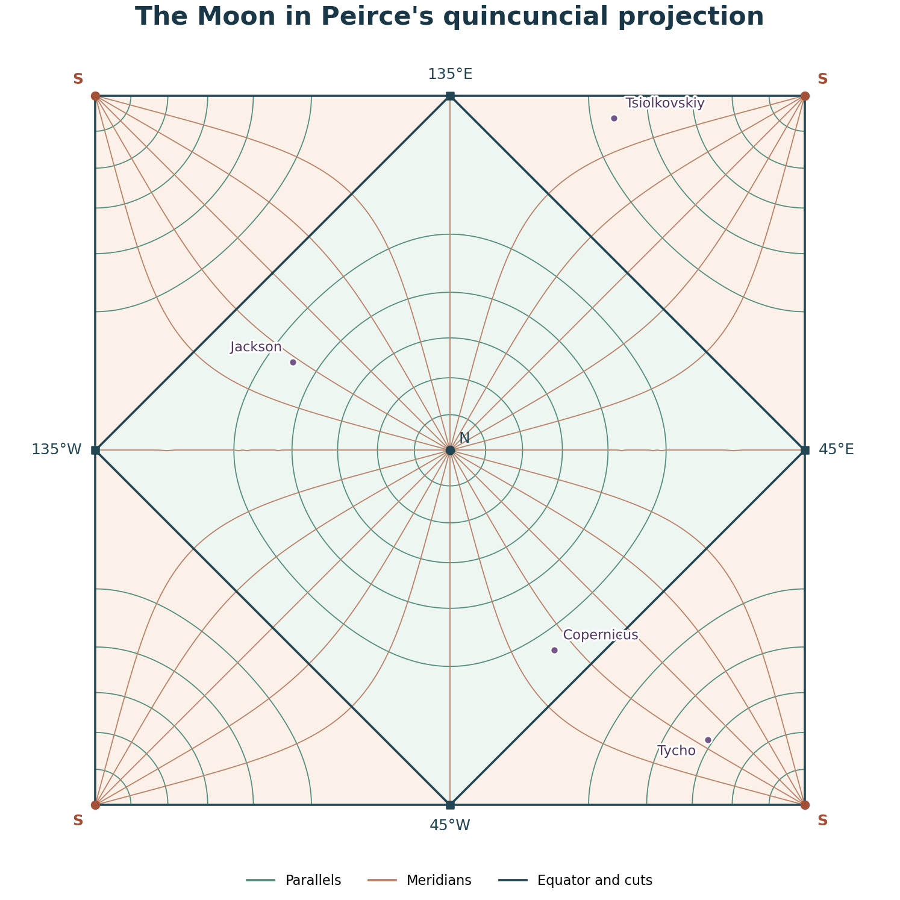
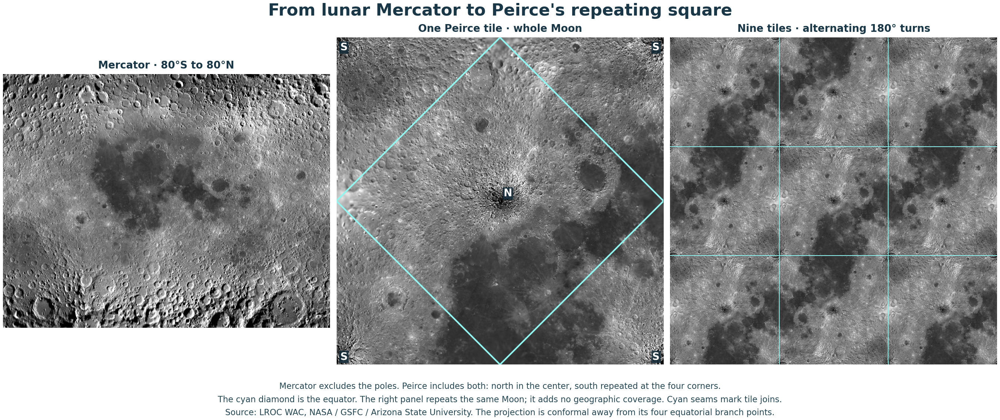

# Global lunar graticule in Peirce's quincuncial projection

The northern hemisphere fills the central diamond. The four surrounding
triangles contain the southern hemisphere. The point marked **N** is the
north pole. Each **S** marks a copy of the same south pole across the map
cuts. Both halves of each outer edge represent the same southern meridian.
[Peirce, 1879](https://www.jstor.org/stable/10.2307/2369491) ·
[PROJ square convention](https://proj.org/en/stable/operations/projections/peirce_q.html)



Crater markers are catalog centers on the spherical graticule.
[Copernicus](https://planetarynames.wr.usgs.gov/Feature/1296) ·
[Jackson](https://planetarynames.wr.usgs.gov/Feature/2781) ·
[Tycho](https://planetarynames.wr.usgs.gov/Feature/6163) ·
[Tsiolkovskiy](https://planetarynames.wr.usgs.gov/Feature/6108)

## Assembly and boundary conventions

The [northern prototype](peirce-hemisphere.md) supplies a square map for
absolute latitude. For southern latitude, select the sector by relative
longitude and reflect its square coordinate across the corresponding
equatorial side. Multiplying by `(1 + i)/2` rotates and scales the result
so the outer tile is `[-1, 1] × [-1, 1]`.

The cuts start at equatorial longitudes `45° + 90°j` relative to the
central meridian. Each cut has two copies on one outer edge. The function
returns the copy from the sector immediately east of an exact cut.
The equator joins the two hemispheres along the interior diamond. Its
four vertices are the exceptional points of the projection, where the
ordinary local conformality of the map fails.

## Verification

Tests check the equator from both sides, the paired edge limits, all four
south-pole copies, and rotation of the central meridian. A separate
comparison used PROJ 9.5.1 with
`+proj=peirce_q +shape=square +lon_0=0 +R=1`. Dividing the PROJ
coordinates by `2 R_F(0, 1, 2)` gives the same normalization. The
maximum absolute difference was `2.62e-8` across 432 points.

```bash
python examples/peirce_global.py
python examples/peirce_global.py --compare-proj  # requires pyproj with PROJ 9+
```

```python
from pyconformal.cartography import peirce_quincuncial

w = peirce_quincuncial(longitude=-11.22, latitude=-43.30)
```

The [global lunar mosaic](peirce-mosaic.md) inverse-samples LROC imagery
into this square and measures local scale relative to the spherical surface.

## Joining the pieces



Run `python examples/peirce_tessellation.py` to reproduce the comparison.
Mercator is shown between 80° S and 80° N and excludes the poles. The
Peirce square contains the whole sphere: the north pole is at the center,
and the south pole has four corner copies. Adjacent tiles are rotated
180° in a checkerboard pattern. The two halves of each outer edge then
match geographically across the join. Repetition changes the arrangement,
not the surface coverage.

The inverse-map regression test compares longitude and latitude at 401
samples on each of the four joins, including pole copies and equatorial
cut points. The graticule shows the structure; the mosaic shows the
surface and scale; the tiling shows how neighboring squares connect.
