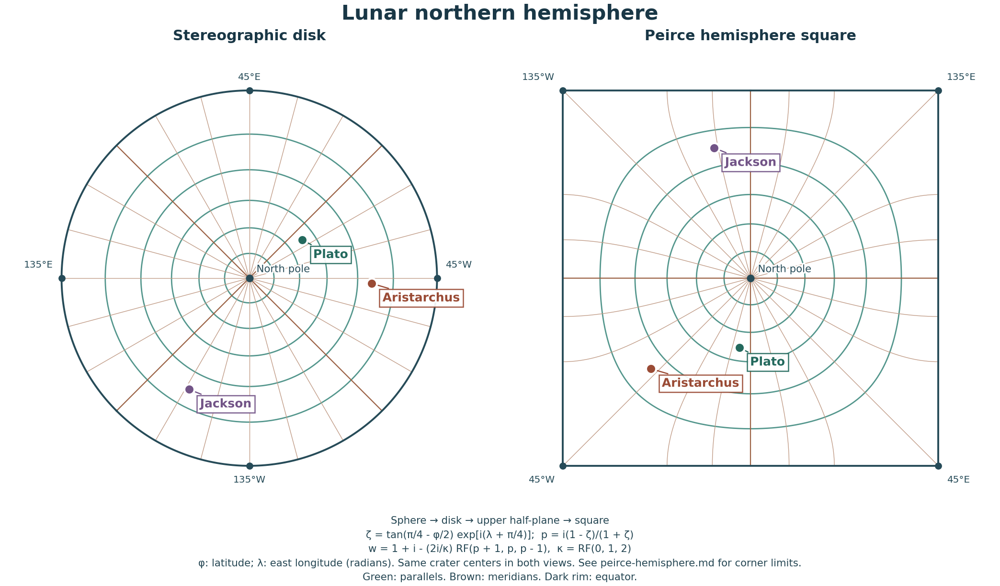

# Peirce projection of the lunar northern hemisphere

The thesis proposes continuing from Schwarz–Christoffel to Peirce's
quincuncial projection. This example builds its northern hemisphere
square. The same graticule and three lunar craters are shown in
stereographic disk coordinates and in the square. [Peirce, 1879](https://www.jstor.org/stable/10.2307/2369491)



## Projection

For spherical northern latitude `φ` and east-positive longitude `λ`,
stereographic projection places the north pole at the disk center and
the equator at radius 1. Its radial coordinate is
`tan((π/2 − φ)/2)`. The disk angle is `λ − λ₀ + π/4`, where
`λ₀` is the central meridian. The Cayley map sends the disk into the
upper half-plane and the [Schwarz–Christoffel map](schwarz-christoffel-square.md)
sends that half-plane to the square. The outputs are dimensionless,
with real and imaginary coordinates in `[-1, 1]`.

| Equatorial longitude relative to λ₀ | Square corner |
| --- | --- |
| 45° E | `1 − i` |
| 135° E | `1 + i` |
| 135° W | `−1 + i` |
| 45° W | `−1 − i` |

The graticule uses 15° intervals. Markers use published crater centers
as spherical coordinates for this illustration. [Aristarchus](https://planetarynames.wr.usgs.gov/Feature/380) ·
[Plato](https://planetarynames.wr.usgs.gov/Feature/4757) ·
[Jackson](https://planetarynames.wr.usgs.gov/Feature/2781)

## Verification

Tests check the pole, equator, corner order, longitude wrapping and
local orthogonality. At `λ₀ = 0`, a comparison with PROJ 9.5.1 used
`+proj=peirce_q +shape=nhemisphere +lon_0=0 +R=1`. Dividing the
PROJ coordinates by `√2 R_F(0, 1, 2)` puts both outputs on the
same square scale. The maximum absolute coordinate separation was
`3.34e-8` across 192 samples. [PROJ Peirce quincuncial](https://proj.org/en/stable/operations/projections/peirce_q.html)

From the repository root after installing the package, run:

```bash
python examples/peirce_hemisphere.py
python examples/peirce_hemisphere.py --compare-proj  # requires pyproj and PROJ 9+
```

```python
from pyconformal.cartography import north_hemisphere_to_square

w = north_hemisphere_to_square(longitude=-9.38, latitude=51.62)
```

The [global graticule](peirce-global.md) adds the four southern triangles
and verifies the joins and repeated boundary points.
