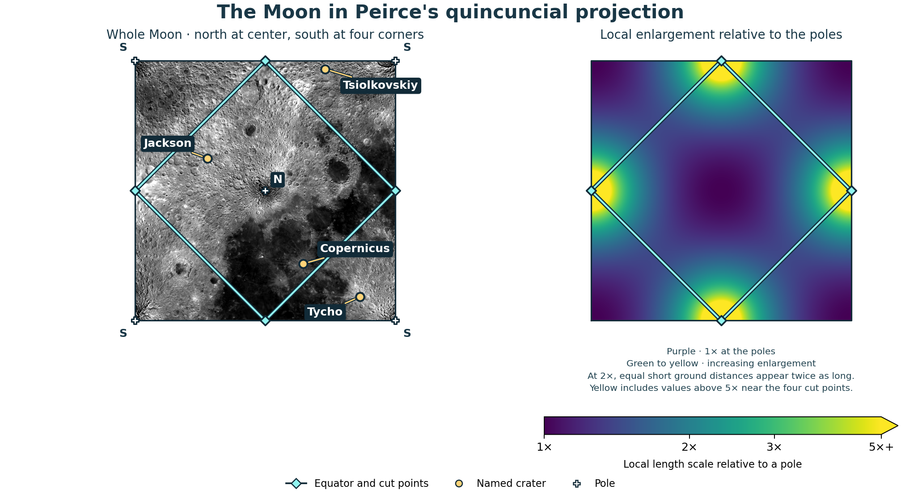

# Global lunar mosaic in Peirce's quincuncial projection

The cyan line marks the equator and the four diamonds mark the
equatorial cut points. Amber dots mark the catalog coordinates of
Copernicus, Jackson, Tycho and Tsiolkovskiy. White crosses identify
the poles. The four occurrences of **S** represent the same south pole.
[Global graticule and cut conventions](peirce-global.md)



## Image and registration

The supplied `examples/lunar-global-wac.jpg` is an 1800 by 900
grayscale equirectangular image requested from ASU's LROC WMS, layer
`luna_wac_global`. Its extent is [−180°, 180°] east-positive longitude
and [−90°, 90°] latitude. The WMS label `EPSG:4326` specifies the
request's geographic axis convention. The coordinates in this example
refer to a spherical Moon. [LROC product and attribution](https://data.lroc.im-ldi.com/lroc/view_rdr/WAC_GLOBAL) ·
[Exact WMS request](https://webmap.lroc.asu.edu/?SERVICE=WMS&VERSION=1.1.1&REQUEST=GetMap&LAYERS=luna_wac_global&STYLES=&SRS=EPSG:4326&BBOX=-180,-90,180,90&WIDTH=1800&HEIGHT=900&FORMAT=image/jpeg)

LROC WAC imagery credit goes to NASA/GSFC/Arizona State University.
The bundled image has five pixels per degree and is intended for this
global visualization. [Speyerer et al., 2011](https://www.lpi.usra.edu/meetings/lpsc2011/pdf/2387.pdf)

## Inverse resampling and local scale

This is the imagery-and-scale companion to the [global graticule](peirce-global.md),
not a different projection. The north pole occupies the central diamond's
center. The four corners show the same south pole in four boundary
copies. The [Mercator and repeated-tile comparison](../examples/peirce_tessellation.png)
places both views in one sequence. The [gallery](../examples/index.html)
links that sequence to the hemisphere prototype and the thesis tracing.

Each pixel center of the 1100 by 1100 output tile is inverted to
spherical longitude and latitude and sampled bilinearly. Longitude
wraps across the antimeridian and the polar rows are clamped. The
inverse unfolds the southern triangles, applies the lemniscate sine
to recover stereographic disk coordinates, and then inverts the
stereographic projection. It uses real-argument Jacobi functions with
addition and imaginary-argument identities.
[NIST DLMF §22.6](https://dlmf.nist.gov/22.6) · [NIST DLMF §22.8](https://dlmf.nist.gov/22.8)

The color panel expresses local length scale relative to its value at
either pole. Purple is 1×. Green and yellow indicate increasing
enlargement. At 2×, equal short ground distances appear twice as long
as at a pole, in any direction. The corresponding local area factor
is 4× relative to a pole. Yellow includes all values above 5×, as
indicated by the arrow on the color bar. Tick spacing is logarithmic.

The underlying calculation measures normalized tile distance per radian
of arc on the spherical Moon. For disk coordinate `ζ`, with
`K = R_F(0, 1, 2)`, the scale is
`(1 + |ζ|²)/(2 K √|1 − ζ⁴|)`. Dividing by the pole value
`1/(2K)` gives the relative scale displayed. It grows without
bound toward the four equatorial singularities.

Tests check inverse round trips across both hemispheres, the four
landmark coordinates, paired cut points, poles, raster wrapping
and the scale against numerical derivatives. The figure uses the
0° central meridian.

```bash
python examples/peirce_mosaic.py
python -m pytest tests/test_peirce_mosaic.py
```

```python
from pyconformal.cartography import peirce_quincuncial_inverse

longitude, latitude = peirce_quincuncial_inverse([0j, 0.3 + 0.5j])
```
