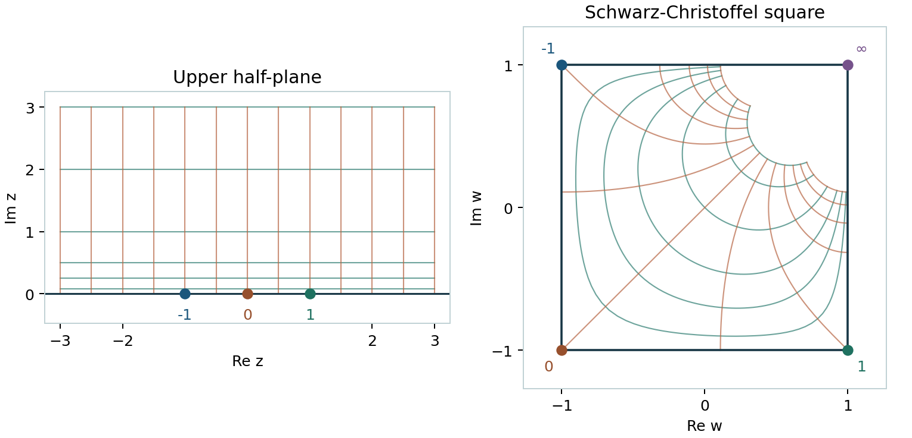

# From the upper half-plane to a square

This example completes the fixed-prevertex calculation in Figure 3.17,
page 53, of Vega Penagos & Olivero Zapata (2015). The target is the square
with real and imaginary coordinates between −1 and 1.

[Open the interactive example](../examples/schwarz-christoffel-square.html)
in a browser. The demo evaluates the same normalized Carlson formula as
the Python API, using numerical duplication in the browser. [NIST DLMF §19.36](https://dlmf.nist.gov/19.36)

The [electrostatics mode](square-electrostatics.md) uses this map to solve
a two-dimensional electrode problem.
The [thermal example](square-heat.md) adds a separate Dirichlet problem
with varying temperatures on all four square edges. Both browser pages
load the shared `examples/sc-square.js` numerical kernel; keep that file
beside the HTML pages. The [thesis companion](thesis-guide.md) links the
map to exercises and the original argument.

| Source | −1 | 0 | 1 | ∞ |
| --- | --- | --- | --- | --- |
| Image | −1 + i | −1 − i | 1 − i | 1 + i |



The source plot shows a finite window of the upper half-plane. The grid
therefore covers only part of the square, while all four corners are marked.

## Normalization

$$
S(z)=1+i-\frac{2i}{\kappa}R_F(z+1,z,z-1),\qquad\kappa=R_F(0,1,2).
$$

See the [notation guide](notation.md) for domains, units and symbol conventions.

Set `K = R_F(0, 1, 2) ≈ 1.3110287771460598`, where `R_F` is Carlson's
symmetric elliptic integral of the first kind. The map is
`w(z) = 1 + i − (2i/K) R_F(z+1, z, z−1)`.
With the Schwarz–Christoffel integral based at ∞ and each square root
continued through the upper half-plane, the constants are `A = i/K`
and `B = 1 + i`. [NIST DLMF §19.32](https://dlmf.nist.gov/19.32)

## Verification

The automated tests check the four corners, the image of the center point
`z = i`, the boundary intervals, the one-sided limits and a second
evaluation by quadrature after mapping the half-plane to the disk.
For an additional check, the disk integral was evaluated as a
hypergeometric function at 35 and 60 decimal digits. Across 54 interior
points and 14 real boundary points, the largest absolute difference
between the Python map and the 60-digit reference was `6.7e-16`. The two
reference precisions differed by at most `1.5e-34` on those samples.

To regenerate the figure and run the automated checks, run these commands
from the repository root after installing `.[dev]`.

```bash
python examples/schwarz_christoffel_square.py
python -m pytest tests/test_exponential_and_sc_square.py
```

To evaluate a point directly, use the Python API.

```python
from pyconformal.sc import upper_half_plane_to_square

print(upper_half_plane_to_square(0.5 + 0.5j))
```
